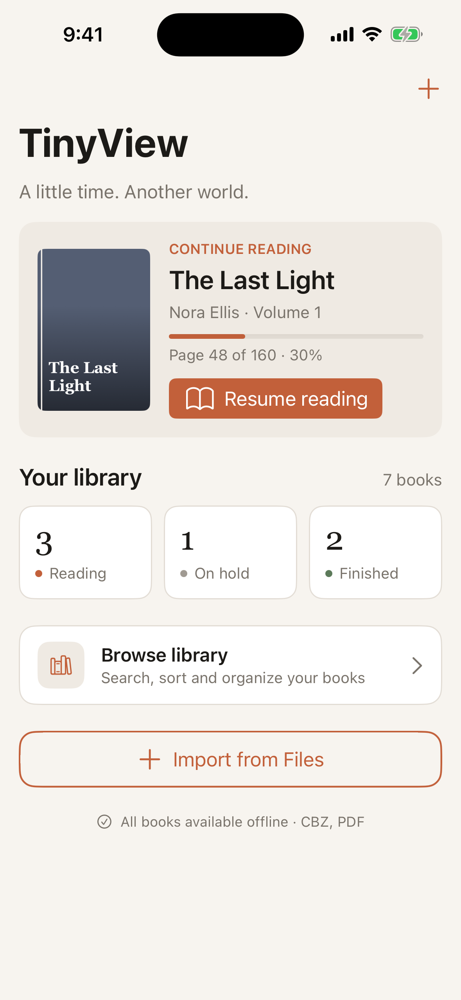
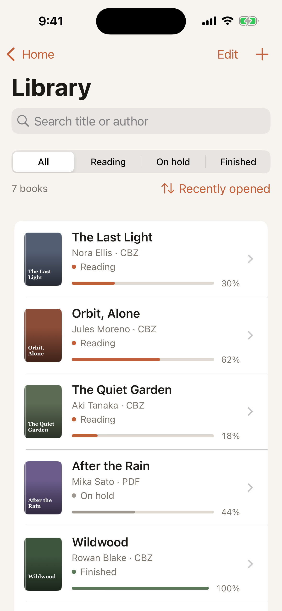
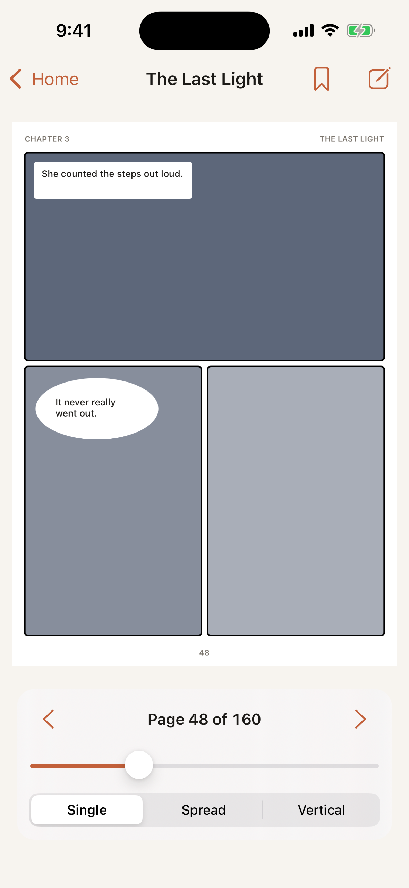
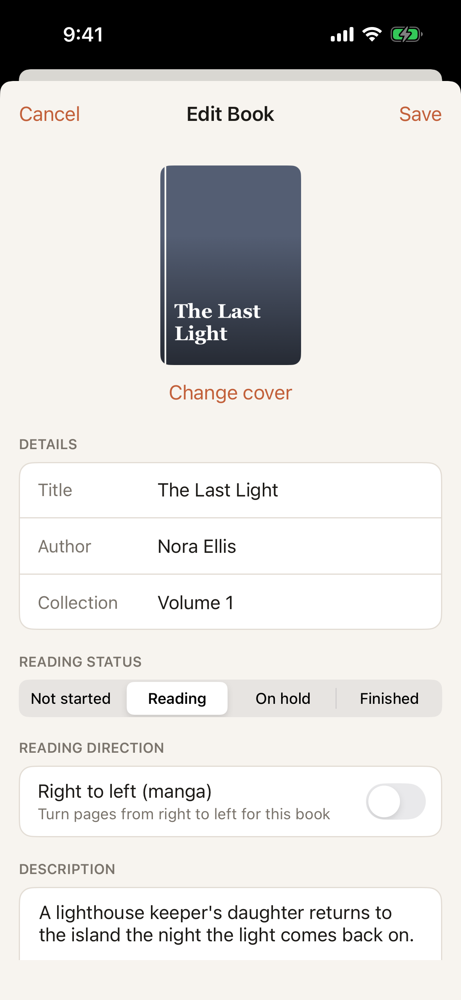

# TinyView

CPSC 411 iOS Mobile Application Development, Final Project Milestone 1 (UIKit user interface)

## Application name

**TinyView**

## Project description

TinyView is an offline comic, manga and PDF reader for iPhone. People who collect digital comics usually end up with CBZ and PDF files scattered across their phone, and most readers either only open one format or make you start over every time you close a book. TinyView keeps every book in one library, remembers the exact page you stopped on, tracks whether each book is in progress, on hold or finished, and supports right to left reading for manga. It is built for anyone who reads comics or manga on their phone and wants a simple, private library that works without an internet connection. For Milestone 1 the app uses hard coded sample books and draws placeholder covers and pages in code; real file import and rendering come in Milestone 3.

## Screen list

1. **home_view_controller (Home):** The main screen and root of the navigation stack. Shows a Continue Reading card for the most recently opened book with a Resume reading button, counts of books that are reading, on hold and finished, a Browse library row, and an Import from Files button.
2. **library_view_controller (Library, list screen):** A UITableView of every book with a custom cell showing the cover, title, author, format, status and progress. Includes a search bar (title or author), a segmented control that filters by status, a sort menu (recently opened, title, progress), and an Edit mode for deleting books or opening them in Edit Book.
3. **reader_view_controller (Reader, detail screen):** Shows one page of the selected book in a zoomable UIScrollView. Tap to show or hide the controls, double tap to zoom, swipe or use the arrows to turn pages, drag the slider to jump to a page, and switch between Single, Spread and Vertical modes. Progress saves automatically on every page turn.
4. **edit_book_view_controller (Add / Edit Book):** A form for adding a new book or editing an existing one, with a cover preview, text fields for title, author and collection, a reading status segmented control, a right to left (manga) switch and a description text view. Cancel and Save buttons sit in the navigation bar.

## Screen navigation diagram

```
                         ┌────────────┐
                         │    Home    │
                         └────────────┘
              ┌────────────────┼────────────────┐
     Browse   │        Resume  │                │  + or Import
     library  ▼        reading ▼                ▼  from Files
      ┌─────────────┐   ┌─────────────┐   ┌─────────────────┐
      │   Library   │──▶│   Reader    │   │ Add Book sheet  │
      └─────────────┘   └─────────────┘   └─────────────────┘
              │             │ pencil
              │             ▼
              │      ┌─────────────────┐
              └─────▶│ Edit Book sheet │
   Edit mode + tap,  └─────────────────┘
   or + for Add Book
```

Tapping a row in Library opens the Reader. Home, Library and Reader are pushed on a UINavigationController. Add Book and Edit Book are presented as sheets with Cancel and Save.

## Screenshots

Screenshots are taken automatically in the iOS Simulator by the GitHub Actions workflow on every push.

| Home | Library | Reader | Edit Book |
| --- | --- | --- | --- |
|  |  |  |  |

## UIKit concepts used

| Requirement | Where |
| --- | --- |
| UIViewController | Every screen is its own view controller, built in code (Option B, programmatic UIKit) |
| View hierarchy | Scroll view, stack views, cards and controls nested per screen in `build_layout()` |
| Auto Layout | Anchors and NSLayoutConstraint on every screen, pinned to the safe area and layout guides, no fixed frames |
| UIStackView | Home sections, stat tile row, continue reading card, table cell layout, reader controls, edit form rows |
| UITableView | Library screen with `UITableViewDataSource`, a custom `book_cell`, row selection and swipe to delete |
| Navigation | UINavigationController push for Library and Reader, modal sheets for Add and Edit Book |
| Controls | UIButton, UILabel, UITextField, UITextView, UISwitch, UISlider, UISegmentedControl, UIImageView, UIProgressView, UISearchController |

## How it builds without a Mac

None of the team has a Mac, so the Xcode project is generated from `project.yml` with [XcodeGen](https://github.com/yonaskolb/XcodeGen) and built on a GitHub hosted macOS runner. The workflow in `.github/workflows/build_and_screenshot.yml`:

1. Generates `TinyView.xcodeproj`
2. Builds the app for the iOS Simulator
3. Launches it four times with `-screenshot_screen home|library|reader|edit` and saves a screenshot of each
4. Uploads the screenshots and commits the generated Xcode project and screenshots back to the repo

To open it on a Mac: `brew install xcodegen`, run `xcodegen generate` in the repo root, then open `TinyView.xcodeproj`.

## Project structure

```
TinyView/
  app_delegate.swift               app entry point
  scene_delegate.swift             window, navigation controller, screenshot routing
  app_theme.swift                  shared colors, label helper, placeholder cover drawing
  book_item.swift                  book model and reading status
  book_store.swift                 in memory sample data
  book_cell.swift                  custom UITableViewCell for the library
  home_view_controller.swift       screen 1
  library_view_controller.swift    screen 2
  reader_view_controller.swift     screen 3
  edit_book_view_controller.swift  screen 4
project.yml                        XcodeGen project definition
```
